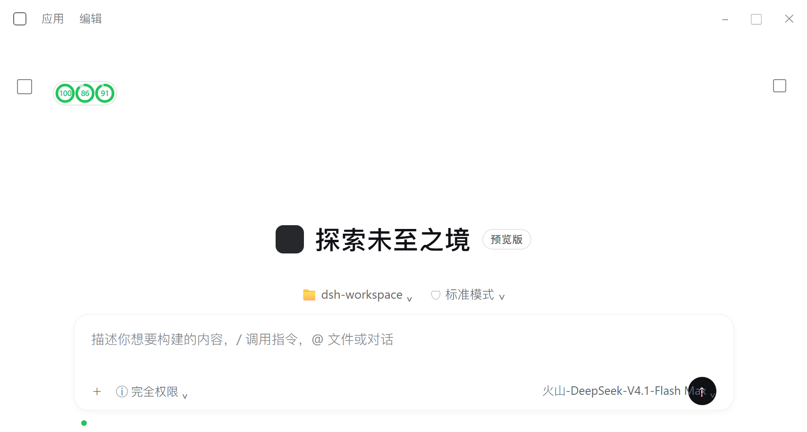
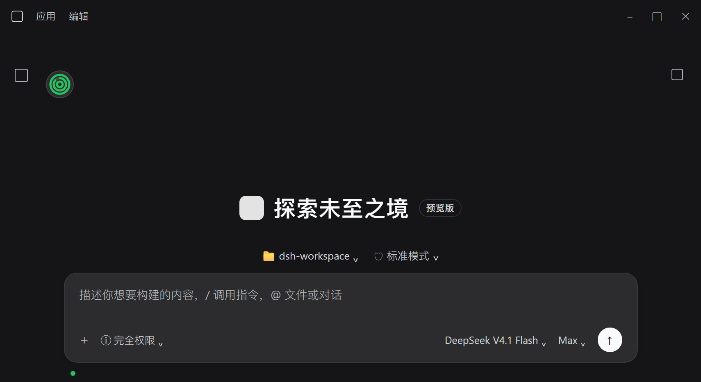
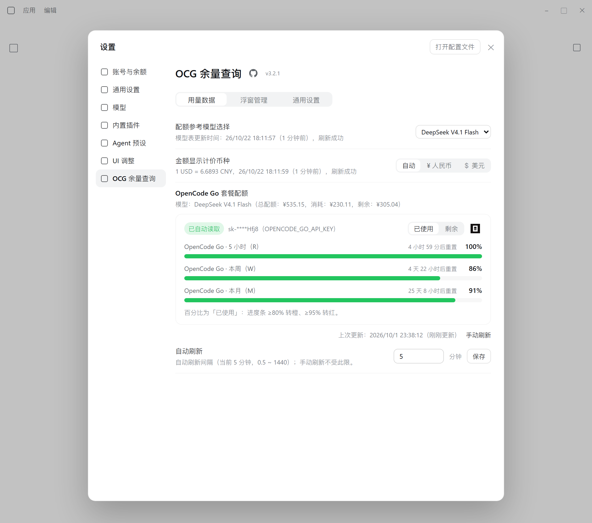
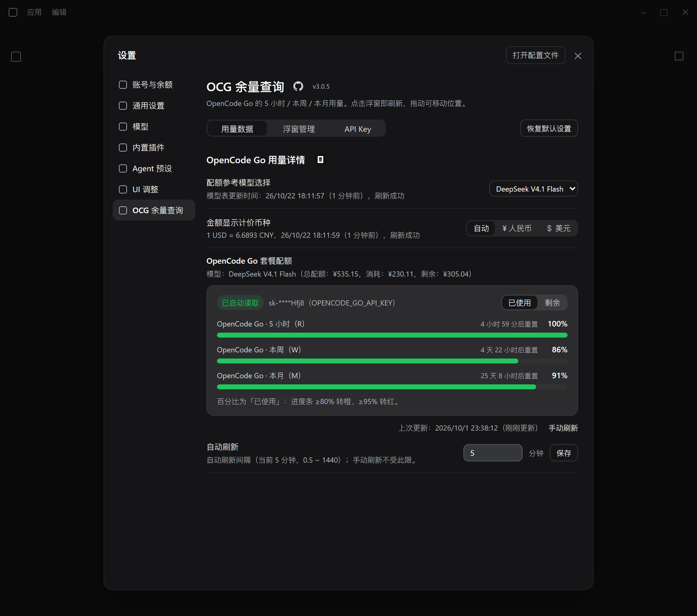
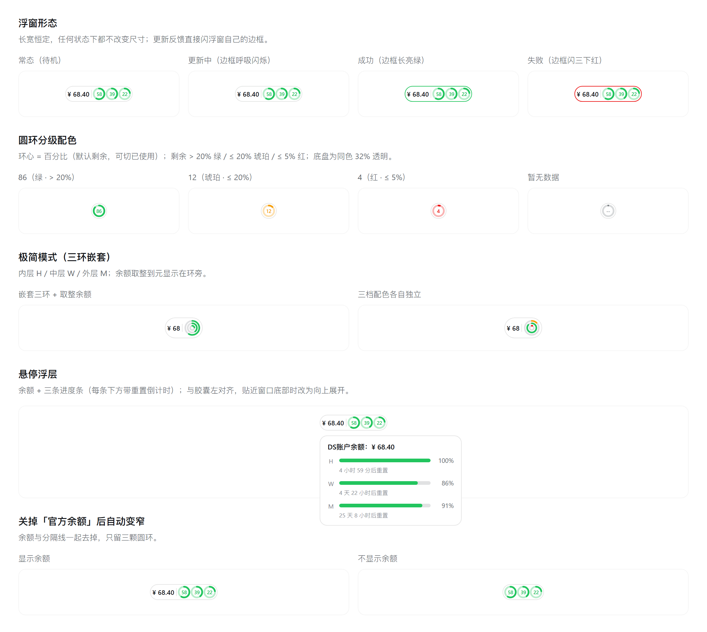

# OCG Balance & Usage · dsh-opencode-go-usage

|  | **Merges your DeepSeek balance and OpenCode Go's three usage windows (5-hour R / weekly W / monthly M) into one floating pill**, with a settings page of the same name. |
|:------------------------:| ---------------------------------------------------------------------------------- |

<p align="center">
  <a href="LICENSE"></a>
  <a href="https://github.com/verneuil/dsh-opencode-go-usage/releases/latest"></a>
  <a href="https://www.npmjs.com/package/@verneuil/dsh-opencode-go-usage"></a>
  <a href="https://dsh-plugin.org/plugins/verneuil/dsh-opencode-go-usage"></a>
  <a href="https://www.dsh.so/artifact/dsh-opencode-go-usage-15/"></a>
  <a href="https://awesome-dsh-plugin.com/p/verneuil/dsh-opencode-go-usage"></a>
</p>

<p align="center">
  <a href="README.md">中文</a> · <b>English</b> · <a href="CHANGELOG.md">Changelog</a> · <a href="https://github.com/verneuil/dsh-opencode-go-usage/issues">Feedback</a>
</p>

*An unofficial [DeepSeek Harness](https://github.com/deepseek-ai) plugin that shows your DeepSeek balance and OpenCode Go usage (Rolling / weekly / monthly) in one floating pill, with click-to-refresh, border-flash feedback, drag-to-snap and a hover popover.*

## Contents

- [Features](#features) · [Installation](#installation) · [Usage](#usage) · [Settings page](#settings-page)
- [Screenshots](#screenshots) · [Data sources](#data-sources) · [Anatomy](#anatomy)
- [Configuration](#configuration) · [Robustness](#robustness) · [Known limitations & disclaimer](#known-limitations--disclaimer) · [License](#license)

## Features

**The pill and the hover popover**

- **OpenCode Go quota amounts + DeepSeek balance display**:
  - The balance area on the pill's left can show either the **DeepSeek balance** or the **OCG quota remaining worked out from a reference model**;
  - the OCG model list and quota are fetched automatically, falling back to the bundled model table and quota data when the fetch fails.

- **Three rings show each window's usage**:
  - OpenCode Go's three windows are drawn as ring progress indicators, and **clicking the pill refreshes them**;
  - the number in each ring's centre is a percentage (**Used** by default, switchable to **Left** in settings): > 20% left green / ≤ 20% amber / ≤ 5% red.

- **Hover popover**:
  - hovering the pill opens a panel with three separate usage bars showing the percentage and the reset time;
  - it can also show both balances at once (**DeepSeek account balance** and **OpenCode Go quota left** — either can be switched off on the “Floating pill” tab).

- **OCG quota conversion**:
  - pick a **reference model** on the settings page (DeepSeek V4.1 Flash by default; any official OpenCode Go model is available) and the plugin works out the **used / remaining amount** from “that model's **Go-tier** monthly quota × this month's used percentage”, shown both in settings and in the hover popover;
  - free models read “Free”, unlimited ones “Unlimited”, and the remaining quota and similar figures all show `--` .
- **Amount currency**:
  - every amount (the DS balance and the OCG quota) can be priced in **¥ CNY / ＄ USD / auto** (¥ in the Chinese UI, ＄ in the English UI);
  - the rate is fetched automatically, falls back to a bundled rate, and conversion only affects the display.
- **Minimal mode**:
  - three **nested** rings (R inner / W middle / M outer) with the balance **rounded to whole units** shown beside them — a more compact pill (the normal mode is “balance + three separate rings”);
  - turning “show a balance on the pill's left” off as well gives the **most compact form**: nested rings only, taking up the least space.
- **Other details**:
  - **Drag to snap**: on release the pill snaps to the nearest reference line (composer card edge / window edge), and keeps following it when the window resizes, the side panel opens or the chat width changes.
  - **Fixed size**: the pill never changes size in any state (the feedback layer is an absolutely positioned overlay that does not participate in layout).

**General**

- **Zero dependencies**: plain JavaScript — **no build step, no third-party runtime dependencies** (only `require('react')`, provided by the host).
- **Bilingual UI**: every interface string goes through the client locale dictionaries and follows the DSH language setting instantly (pill, settings page, menu label and all action messages).

## Installation

**Requirements**: DeepSeek Harness desktop (the app bundles node / pnpm — nothing else to install). This plugin follows the official DSH plugin conventions: you do **not** hand-edit the profile's `package.json` / `cordis.patch.yml`, and you should not run pnpm inside the profile directory.

In DSH, open the **plugin manager → “Install plugin” dialog → paste one of the specs below → install** (the dialog drives pnpm and installs one spec at a time):

| Method                                     | Spec to paste                                                                                                    |
| ------------------------------------------ | ---------------------------------------------------------------------------------------------------------------- |
| **Straight from GitHub** (recommended)      | `github:verneuil/dsh-opencode-go-usage`                                                                          |
| **From npm**                              | `dsh plugin --profile web add @verneuil/dsh-opencode-go-usage`                                                                 |
| **Pin a version**                          | `github:verneuil/dsh-opencode-go-usage#v3.0.3` (replace with any published tag)                                    |
| **Release tarball**                        | `https://github.com/verneuil/dsh-opencode-go-usage/releases/download/v3.0.3/dsh-opencode-go-usage-3.0.3.tgz`    |
| **Release URL (always latest)**            | `https://github.com/verneuil/dsh-opencode-go-usage/releases/latest/download/dsh-opencode-go-usage.tgz`            |
| **Offline tgz**                            | `file:D:/your/path/dsh-opencode-go-usage-3.0.3.tgz`                                                             |

The equivalent command line (`dsh plugin` automatically adds dependencies that declare `dsh.bundle` to the profile's bundles — no hand-written patch needed):

```sh
dsh plugin --profile web add github:verneuil/dsh-opencode-go-usage
```

Follow the on-screen prompt to reload afterwards (replacing an installed JavaScript module generation requires restarting DSH).

- **Bundle-only installs**: the plugin manager rejects dependencies without a bundle patch; this package ships its own `cordis.patch.yml`, so it qualifies.
- **Upgrading = uninstall then reinstall**: the plugin manager offers no version picker and no upgrade button. Uninstalling removes the dependency record and reinstalling resolves it afresh, so **that is how you get a new version**; installing the same spec over the top will not pick up a new commit.
- Every version's changes are listed in [CHANGELOG.md](CHANGELOG.md) (Chinese and English).

## Usage

- **Click the pill** = refresh the balance, the usage, the model list and the exchange rate immediately (or just wait for the automatic refresh).
- **Drag the pill** = move it; it snaps on release. The “Reset position” button restores the default position (top-left of the window).
- **The balance line on the pill's left** = pick one in settings: **DS balance** / **OCG quota left** (see [Settings page](#settings-page)).
- **Settings page** = `Settings → Plugins → OCG Usage`.

## Settings page

The settings page has three tabs: **Usage data** (default) / **Floating pill** / **API Key**;

**Restore defaults** sits permanently at the right end of the tab bar and writes everything back from any tab.

Next to the page title sit the **GitHub icon and the current version** (e.g. `v3.0.3`); clicking the icon opens this repository.

**Usage data**

- The **OpenCode icon** sits right next to the “OpenCode Go usage” heading; clicking it opens the [OpenCode account page](https://opencode.ai/console).
- **Quota reference model**: a dropdown listing every official OpenCode Go model (default **DeepSeek V4.1 Flash**); the note beneath shows the **model-table update time** and the result of this refresh.
- **Amount display currency**: a three-way choice — `Auto` / `¥ CNY` / `＄ USD`; the note beneath shows the **current rate, when it was fetched** and the refresh result.
- **Plan quota**: `Model: X (total: Z, used: Y, left: W)`; the amounts come from the **reference model's Go-tier monthly quota × this month's used percentage**.
- **Usage details**: a progress bar, the percentage (basis is selectable), reset countdown and API status for each of the three windows.
- **Progress basis** (top-right of the usage card): **Used** / **Left** — the pill and the settings rows follow; defaults to **Used**.
- Two rows below the card:
  - **manual refresh + last-updated time** (after a successful refresh it shows “Updated (time)” and **falls back to “Last updated: …” after 3 seconds**);
  - the **auto-refresh interval** (set a number of minutes and save; range 0.5 – 1440).
- **Failures name the source**: whenever a fetch fails, the error line appears **left of the manual refresh button** (and at the very bottom of the hover popover), stating whether **OCG usage / DeepSeek balance / exchange rate / model list & quota** broke.

**Floating pill**

- **Pill master switch**: turning it off greys out the rows below and makes them non-interactive.
- **Show a balance on the pill's left** (switch): shows one balance line on the pill's left; turning it off also collapses the row below.
- **Pill left-side balance data** (two-way): `DS balance` / `OCG quota left` — which data that left line uses (the DS balance includes bonus credit).
- **Hover popover balance data** (checkbox dropdown): `DS balance` / `OCG quota left` — show one, both, or **neither** (the popover then keeps only the three progress bars); **clicking outside the dropdown closes it**.
- **Minimal mode** (switch): nested rings (R / W / M) with the rounded balance shown beside them.
- **Reset the pill position**: back to the default position (top-left of the window).

**API Key**

- **Overrides for both keys** (leave empty to use the DSH credential store; clear them at any time to go back to automatic).

**Shared behaviour**

- **Restore defaults** (right end of the tab bar): one click writes back “Used basis / 5-minute auto-refresh / Minimal on / no balance on the pill / reference model DeepSeek V4.1 Flash / currency auto / left side = DS balance / both popover balances on / top-left default position” — the same set a fresh install starts with.

- **Per-row feedback**: each action's message appears in the row it belongs to — red on failure, green on success. Messages live in a slot on the title row, so **showing and hiding them does not shift the layout** and they **disappear after 3 seconds**.

Because the plugin ships its own settings page, the host side calls the official `settings.configure({ auto: false })` to switch off the auto-generated form, avoiding two duplicate configuration UIs.

## Screenshots

> All five are **rendered illustrations** of the interface, built from the plugin's real stylesheet and the host theme tokens. The two settings images show the “Usage data” tab (quota reference model, amount currency and the one-line plan quota); the states image includes the latest hover popover (account-balance row + quota-left row + three progress bars, at the fixed 232 px width with right-aligned amounts).

| Pill · light                                  | Pill · dark                                 |
| --------------------------------------------- | ------------------------------------------- |
|    |    |
| **Settings · light**                          | **Settings · dark**                         |
|  |  |

**States and colour grades** (refreshing / success / failure / three grade colours / minimal mode / most compact form / narrowed after hiding the balance)



## Design goal: minimal

- Blend into the existing DeepSeek Harness UI as much as possible: unobtrusive, never shouting, yet still letting you read your usage at a glance — evolved from a long progress bar into the three rings you see today.
- Only OpenCode Go is supported for now; other coding plans have not been tackled yet.

## Data sources

```
GET https://opencode.ai/zen/go/v1/usage                    # OpenCode Go usage
Authorization: Bearer <OpenCode Go API Key>

GET https://api.deepseek.com/user/balance                  # DeepSeek balance
Authorization: Bearer <DeepSeek API Key>

GET https://opencode.ai/v2/docs/console/go                  # OpenCode Go model list + per-model monthly quota (server-rendered tables)
GET https://open.er-api.com/v6/latest/USD                   # USD/CNY rate (primary, no key)
GET https://api.frankfurter.app/latest?from=USD&to=CNY      # USD/CNY rate (backup, no key)
```

The usage endpoint returns `{ usage: { rolling, weekly, monthly } }`, where each window carries `status` / `percent` (**used** percentage) / `resetsAt`; the balance endpoint returns `balance_infos[]` (the CNY entry is preferred). The UI shows **Used** by default and can be switched to **Left** in settings; the internal value always stays “used”.
The host half performs the fetching and parsing (neither key ever leaves the host process); the client half only reads the configuration projection the host writes.

**The model list and the rate** refresh together with everything else: **manual refresh (button or pill click) forces a refetch**, while auto-refresh reuses the **model table for 24 h and the rate for 1 h**. If both fail, the plugin falls back to its **bundled snapshot** (`go-data.js`, generated 2026-10-22: 29 official models + a rate of 6.689327) and names the failure in the UI. **Quota conversion uses the Go-tier monthly quota from that model table.**

**Key resolution** (independent per side, in priority order):

1. The “manual key” entered on the plugin's settings page (persisted in this row's config; the client-side view masks it);
2. The DSH credential store — `OPENCODE_GO_API_KEY` (then `OPENCODE_API_KEY`) for OpenCode Go, and `DEEPSEEK_API_KEY` for DeepSeek.

## Anatomy

| Part            | Location            | Description                                                                                                            |
| --------------- | ------------------- | ---------------------------------------------------------------------------------------------------------------------- |
| Bundle manifest | `package.json`      | `dsh.bundle.patch` + `dsh.client` (platform web, immediately) + `icon` + `locale/*.json` display metadata                |
| Loader patch    | `cordis.patch.yml`  | Inserts one row, `id: opencode-go-usage` (this row id is also the namespace of the settings form)                       |
| Host half       | `index.js`          | `export const Config` (schemastery) + `apply(ctx, config)`: fetching, parsing, writing back snapshots, auto-refresh      |
| Client half     | `client.js`         | A `window.__ModuleLoader__` lazy factory; only `require('react')`; registers into `shell.overlay` (pill) and `settings.section` (settings page) |

## Configuration

The settings page covers the common options; the fields below can also be edited directly in this row's patch `config`.

| Field                                                          | Description                                                                       |
| -------------------------------------------------------------- | --------------------------------------------------------------------------------- |
| `apiKey`                                                       | Manual OpenCode Go API key (secret). Leave empty to use the DSH credential store   |
| `deepseekApiKey`                                               | Manual DeepSeek API key (secret). Leave empty to use the DSH credential store      |
| `refreshMinutes`                                               | Auto-refresh interval in minutes (default 5); one round refreshes both balance and usage |
| `widgetVisible`                                                | Pill visibility switch                                                             |
| `showBalance`                                                  | Whether the pill shows a balance line on its left (default off)                     |
| `pillBalanceSource`                                            | Data for that left line: `deepseek` DS balance (default) / `quota` OCG quota left   |
| `tipShowBalance`, `tipShowQuota`                               | Whether each popover balance row is shown (both default on; both off leaves only the bars) |
| `quotaRefModel`                                                | Reference model id (default `deepseek-v4.1-flash`; options come from the official model table) |
| `currencyMode`                                                 | Amount currency: `auto` (default) / `cny` / `usd`                                   |
| `percentMode`                                                  | Usage progress basis: `used` (default) or `left`                                   |
| `widgetAnchorX/Y`, `widgetOffsetX/Y`                           | Pill anchoring (written by the client while dragging; defaults to 11 / 50 from the window's top-left) |
| `refreshRequest`                                               | Manual-refresh counter (incremented by the client when the pill is clicked)         |
| `refreshTick`                                                  | The “refreshing” signal the host bumps before each round (read-only on the client, used for the border feedback) |
| `minimalMode`                                                  | Minimal mode: nested rings (with the rounded balance beside them; default on)       |
| `keyStatus`, `keyHint`, `usageError`, `lastUpdated`, `usage`     | Derived OCG usage snapshots (written by the host, read by the client)               |
| `balanceKeyStatus`, `balanceKeyHint`, `balanceError`, `balance` | Derived DeepSeek balance snapshots (written by the host, read by the client)        |
| `goModels`, `goModelsAt`, `goModelsSource`, `goModelsError`     | Derived model-list and quota snapshots (`source` = `live` or `snapshot`)             |
| `fxUsdCny`, `fxAt`, `fxRateDate`, `fxSource`, `fxError`         | Derived USD/CNY rate, its data date and the moment it was fetched                    |

## Robustness

- **Only the seat the official UI reserves for overlays** — `shell.overlay` (`replaceRisk: none`, a click-through layer whose entries opt into pointer events); registering with its own `id` means “added next to existing entries”, replacing nothing official.
- **Obscures no official UI**: it does not register `conversation.composer.dock` and does not clone official components.
- **Styling uses theme tokens only** (`--dsw-alias-*`): a token rename can at worst degrade the look, never crash the render; there are no hard-coded colours.
- **No Harness client packages** (such as `dsh-client-ui-primitives`): those packages change often and plain JS plugins get no type checking, so every control in the pill is hand-written.
- **Host API contract self-check**: on start-up the contracts this plugin actually uses are verified; a mismatch prints a readable warning and skips safely instead of throwing a `TypeError` that would silently deactivate the whole entry.
- **Config as the channel**: the host writes derived snapshots into this row's volatile Config fields and the client reads them via `remote.settings.describe()`; writes are committed outside the HMR transaction (avoiding `HMR transactions cannot be nested`).
- **A failed fetch never clears data**: the last known usage is kept (with 3s / 10s anti-jitter retries), so one network hiccup cannot blank the bars to `--` or persist empty values.
- **Four independent data paths**: usage, balance, model list and exchange rate never block each other — a failure only affects its own field, the UI **names** which one broke, and a failed model list or rate falls back to the bundled snapshot (labelled as such).
- **Manual refresh means a full refetch**: the button (or a pill click) bypasses the TTL and forces the model table and the rate to be re-fetched, so both footnote times follow your manual refresh.
- While no key is available yet, resolution retries in steps (3/8/20/40/60/120 seconds), and three misses are tolerated once a good snapshot exists — avoiding a false “not configured” reading right after startup.

## Known limitations & disclaimer

- **Unofficial plugin**: this project has **no affiliation whatsoever** with DeepSeek or OpenCode; neither endpoint is a long-term frozen public contract, so a major upstream change can break it (the parser already tolerates common variants such as “remaining percentage / used amount and quota / seconds to reset”, and on failure the host puts a readable message in `usageError`).
- **Keys stay on this machine**: the host half calls the two endpoints above directly and goes through no third party; a manual key entered in settings is stored in this machine's plugin config, and the UI only ever shows a masked hint (such as `sk-****5590`).
- **Network hiccups**: occasional cross-border HTTPS timeouts are normal. The pill then keeps the **last known values** and the border turns to a warning colour; the host retries at 3/8/20/40 seconds and recovers automatically.
- **Interface language**: the pill and the settings page are **bilingual (Chinese / English)** and follow the DSH language setting. **Error details** produced by the API layer (such as 401/403 or an unexpected response shape) are still in Chinese.
- **The quota figure is an estimate**: no official endpoint exposes “how much of model X is left right now”, so the plugin estimates it as “that model's **Go-tier** monthly quota × **this month's used percentage**” — for reference only. The monthly percentage is the **whole plan's** progress, not that model's own share. The **Go Plus tier is not covered yet** (the Go tier is always used).
- **The rate only affects display**: the DS balance is originally in CNY and the quota in USD; conversion is purely cosmetic (`auto` = ¥ in Chinese, ＄ in English) and never changes a real bill.
- **The model list can lag**: the bundled snapshot is the official data of 2026-10-22; it updates with each refresh while online, and while offline (or when fetching fails) the snapshot is shown and labelled in the UI.
- **Use at your own risk**: this software is provided “as is” under the MIT licence, without warranty of any kind.

## License

[MIT](LICENSE) © 2026 verneuil

## Feedback

Please open an [issue](https://github.com/verneuil/dsh-opencode-go-usage/issues) for bugs and suggestions; pull requests are welcome. Version history: [CHANGELOG.md](CHANGELOG.md).
