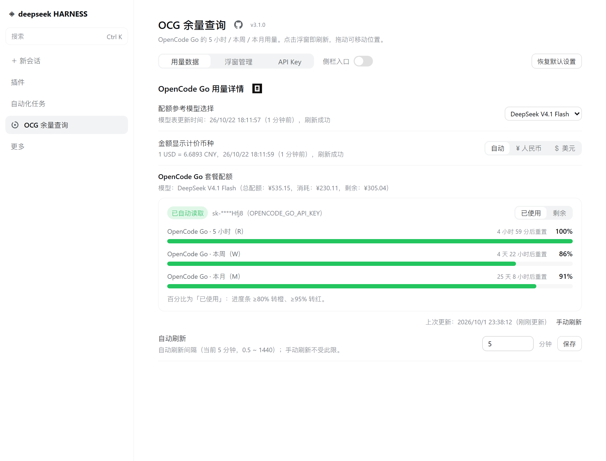

<div align="center">


# OCG 余量查询

**把 DeepSeek 官方余额与 OpenCode Go 三个用量窗口（5 小时 R / 本周 W / 本月 M）合并进同一个悬浮胶囊，另带一个同名设置页**

[](README.md) [](README.en.md)

[](https://github.com/verneuil/dsh-opencode-go-usage/actions/workflows/ci.yml)
[](https://github.com/verneuil/dsh-opencode-go-usage/actions/workflows/codeql.yml)
[](LICENSE)
[](https://github.com/verneuil/dsh-opencode-go-usage/releases/latest)
[](https://www.npmjs.com/package/@verneuil/dsh-opencode-go-usage)
[](https://dsh-plugin.org/plugins/verneuil/dsh-opencode-go-usage)
[](https://www.dsh.so/artifact/dsh-opencode-go-usage-15/)
[](https://awesome-dsh-plugin.com/p/verneuil/dsh-opencode-go-usage)

[更新日志](CHANGELOG.md) · [反馈](https://github.com/verneuil/dsh-opencode-go-usage/issues)

</div>

---

一个非官方的 [DeepSeek Harness](https://github.com/deepseek-ai) 插件：把 DeepSeek 官方余额与 OpenCode Go 的 5 小时 / 本周 / 本月三档用量收进同一个悬浮胶囊 —— 点一下即刷新、边框闪烁反馈、可拖动吸附、悬停展开详情浮层，并自带一个同名的整页设置界面。

## 目录

- [特性](#特性) · [安装](#安装) · [使用](#使用) · [设置页](#设置页)
- [截图](#截图) · [数据来源](#数据来源) · [构型](#构型)
- [配置项](#配置项) · [稳健性设计](#稳健性设计) · [已知限制与免责声明](#已知限制与免责声明) · [许可](#许可)

## 特性

**浮窗与悬停浮层**

- **OpenCode Go配额计算+DeepSeek官方余额展示**：
  - 浮窗左侧的余额区域可选择显示**DeepSeek 官方余额**或**按参考模型折算出的 OCG 配额剩余**；
  - OCG模型列表与配额自动获取，取不到就用内置模型表和配额数据。

- **三环进度条显示窗口用量**：
  - OpenCode Go 三窗口用量，以圆环进度条显示，**点击浮窗即刷新**；
  - 环心数字是百分比（默认**已使用**，可在设置里切为展示「剩余」），剩余 > 20% 绿 / ≤ 20% 琥珀 / ≤ 5% 红。

- **悬停浮层**：
  - 鼠标停在胶囊上，展开浮层面板，显示三根独立的用量进度条，显示用量百分比和重置时间；
  - 此外还支持同时显示两个余额金额（ **DeepSeek 账户余额**、**OpenCode Go 配额剩余**——两者都可在「浮窗管理」页关掉）

- **OCG 配额折算**：
  - 在设置页选一个**参考模型**（默认 DeepSeek V4.1 Flash，可选 OpenCode Go 全部官方模型），插件按「该模型 **Go 档**月度配额 × 本月已用百分比」算出**已消耗 / 剩余金额**，显示在设置页与悬停浮层；
  - 免费模型显示「免费」，无限制模型显示「无限制」，剩余配额等均显示为 -- 。
- **金额计价币种**：
  - 所有金额（DS 余额与 OCG 配额）可选 **¥ 人民币 / ＄ 美元 / 自动**（中文界面 ¥、英文界面 ＄）三种计价方式。
  - 汇率自动获取，取不到就用内置汇率，换算只影响显示。
- **极简模式**：
- **三环显示数据**：极简模式下的外 / 中 / 内三环可分别绑定 R（5 小时）/ W（本周）/ M（本月），右侧带实时预览；选到已被占用的窗口会自动与另一环交换。
  - 使用三环**嵌套**（内 R / 中 W / 外 M）+ 余额**取整到元**显示在环旁，胶囊更紧凑（非极简模式为「余额 + 三颗独立圆环」）；
  - 再关掉「在浮窗左侧显示余额」即为**最精简形态**：只留三环嵌套，占地最小。
- **其他特性**：
  **浮层可交互**：鼠标从胶囊移到浮层上时浮层不会消失（留了 220ms 过渡，跨过两者之间的间隙）；点击浮层与点击胶囊效果相同，都会触发一次手动刷新；浮层边框的刷新闪烁与胶囊完全同步；
  **浮层方向自适应**：贴近窗口底部时向上展开，贴近左右边缘时自动改为向内展开，不会被窗口裁掉；
  **拖动吸附**：松手按**窗口边沿**记录位置（只记边沿 + 偏移，输入框卡片变化不会再带着它漂移），精确到 0.1px；窗口尺寸变化时按锚线保持相对位置；
  - **长宽恒定**：任何状态下浮窗尺寸都不变（反馈层是绝对定位叠加层，不参与布局）。

**其它**

- **零依赖**：纯原生 JS，**无构建步骤、无第三方运行时依赖**（只 `require('react')`，由宿主提供）。
**侧栏入口（可选）**：设置页有「侧栏入口」开关（默认关）。开启后侧栏出现本插件入口，点一下直接打开本插件的整页设置界面（与设置对话框里完全同一套），侧栏图标与设置菜单里的标记一致；
- **中英双语**：全部界面文案走客户端 locale 字典，随 DSH 语言设置即时切换（浮窗、设置页、菜单名与各项操作提示）。

## 安装

**前置**：DeepSeek Harness 桌面版（应用自带 node / pnpm，无需另装）。本插件按 DSH 官方插件规范编写，**不需要**手写 profile 的 `package.json` / `cordis.patch.yml`，也不要在 profile 目录里跑 pnpm。

在 DSH 里打开 **插件管理页 → 「安装插件」对话框 → 粘贴下面任一 spec → 安装**（对话框调用 pnpm，一次只能装一个）：

| 方式                   | 粘贴的 spec                                                                                                       |
| -------------------- | -------------------------------------------------------------------------------------------------------------- |
| **GitHub 直装**（推荐）    | `github:verneuil/dsh-opencode-go-usage`                                                                        |
| **npm 安装**                 | `dsh plugin --profile web add @verneuil/dsh-opencode-go-usage`                                                                 |
| **固定某个版本**           | `github:verneuil/dsh-opencode-go-usage#v3.2.1`（换成任意已发布 tag）                                                   |
| **Release 包**        | `https://github.com/verneuil/dsh-opencode-go-usage/releases/download/v3.2.1/dsh-opencode-go-usage-3.2.0.tgz` |
| **Release 直链（始终最新）** | `https://github.com/verneuil/dsh-opencode-go-usage/releases/latest/download/dsh-opencode-go-usage.tgz`         |
| **离线 tgz**           | `file:D:/你的路径/dsh-opencode-go-usage-3.2.0.tgz`                                                                |

命令行等价写法（`dsh plugin` 会把声明了 `dsh.bundle` 的依赖自动加进 profile 的 bundles，无需手写 patch）：

```sh
dsh plugin --profile web add github:verneuil/dsh-opencode-go-usage
```

装完按页面提示刷新（替换已安装的 JavaScript 模块代需要重启 DSH）。

- **只受理「组合包」**：插件管理页拒绝没有 bundle patch 的依赖，本包自带 `cordis.patch.yml`，符合要求。
- **升级 = 卸载后重装**：插件管理页不提供版本选择器与升级按钮。卸载会移除依赖记录，重装时才会重新解析，因此**这是拿到新版的方式**；直接覆盖安装同一 spec 不会刷新到新提交。
- 每个版本的改动见 [CHANGELOG.md](CHANGELOG.md)（中英双语）。

## 使用

- **点击浮窗** = 立即刷新余额 + 用量 + 模型清单 + 汇率（也可以等自动刷新）。
- **拖动浮窗** = 移动位置，松手自动吸附；「重置位置」按钮可一键回到默认位置（窗口左上角）。
- **浮窗左侧那一行余额** = 在设置里二选一：**DS 官方余额** / **OCG 配额剩余**（详见[设置页](#设置页)）。
- **设置页** = `设置 → 插件 → OCG 余量查询`。

## 设置页

设置页分三个标签：**用量数据**（默认）/ **浮窗管理** / **API Key**；

标签栏右侧常驻 **恢复默认设置**，任何标签下都能一键写回。

页面顶部标题右侧是 **GitHub 图标 + 当前版本号**（如 `v3.2.1`），点击图标打开本插件仓库。

**用量数据**

- 「OpenCode Go 用量详情」标题右侧是 **OpenCode 官方图标**，点击打开 [OpenCode 账户页](https://opencode.ai/console)。
- **配额参考模型选择**：下拉框列出 OpenCode Go 全部官方模型（默认 **DeepSeek V4.1 Flash**）；下方小字显示**模型表更新时间**与本次刷新结果。
- **金额显示计价币种**：三选一： `自动` / `¥ 人民币` / `＄ 美元`；下方小字显示**当前汇率、汇率更新时间**与刷新结果。
- **套餐配额**： `模型：X（总配额：Z，消耗：Y，剩余：W）`；金额按**参考模型的 Go 档月度配额 × 本月已用百分比**折算。
- **用量详情**：三个窗口的进度条、百分比（口径可选）、重置倒计时与接口 status。
- **进度口径二选一**（用量详情卡片右上角）：**已使用** / **剩余**，浮窗与设置页同时跟随；默认**已使用**。
- 卡片下方两行：
  -  **手动刷新 + 更新时间**（成功后显示「已更新（时间）」，**3 秒后自动回落**成「上次更新：…」）；
  -  **自动刷新间隔**（设置分钟数并保存，区间 0.5 ~ 1440）。
- **获取失败点名**：任何一项数据抓取失败，错误行出现在**手动刷新按钮左侧**（悬停浮层**最底部**同样有一行），明确写出是 **OCG 用量 / DeepSeek 官方余额 / 汇率 / 模型列表及配额**中的哪一项失败。

**浮窗管理**

- **浮窗总开关**：关闭后，下面各项整行变灰且不可操作。
- **在浮窗左侧显示余额**（开关）：浮窗左侧显示一行余额；关掉后下一项一并收起。
- **浮窗左侧余额数据**（二选一）：`DS余额` / `OCG配额剩余` —— 决定左侧那一行取哪份数据（DS 余额包含赠金）。
- **鼠标悬停浮层余额数据**（下拉多选）：`DS余额` / `OCG配额剩余` —— 可只显示其一、两个都显示，或**都不显示**（此时浮层只留三条进度条）；**点击下拉范围之外会自动收起**。
- **极简模式**（开关）：三环嵌套（R / W / M）+ 余额取整显示在环旁。
- **重置浮窗位置**：把浮窗放回默认位置（窗口左上角）。

**API Key**

- **两把 Key 的覆盖输入**（留空即用 DSH 凭据库；可随时清空改回自动）。

**共同行为**

**侧栏入口**（标签栏右侧、「恢复默认设置」左边）：开关侧栏里是否出现本插件入口；默认关闭，不影响设置页本身；
- **恢复默认设置**（标签栏最右）：一次写回「已使用口径 / 5 分钟自动刷新 / 极简模式开 / 浮窗不显示余额 / 参考模型 DeepSeek V4.1 Flash / 金额币种自动 / 左侧来源 DS余额 / 浮层两种余额都显示 / 左上角默认位置」—— 新装默认形态就是这一套。

- **每个操作的提示就地出现在该行**，失败红色、成功绿色；提示放在标题行的槽位里，**出现与消失都不顶动排版**，**停留 3 秒后自动消失**。

因为自带设置页，宿主侧调用了官方的 `settings.configure({ auto: false })` 关掉自动生成的表单页，避免出现两个重复的配置界面。

## 截图

> 六张均为**界面示意渲染**：按插件的真实样式与宿主主题令牌生成。设置页两张取自「用量数据」标签（含配额参考模型选择、金额显示计价币种、套餐配额一行小字）；总览图含悬停浮层的最新形态（账户余额行 + 配额剩余行 + 三条进度条，固定宽度 232px，金额右对齐）。 第六张为开启「侧栏入口」后从侧栏打开的整页设置界面。

| 浮窗 · 浅色                                     | 浮窗 · 深色                                    |
| ------------------------------------------- | ------------------------------------------ |
|      |      |
| **设置页 · 浅色**                                | **设置页 · 深色**                               |
|  |  |
| **侧栏入口 · 整页设置**（开启「侧栏入口」后，点侧栏里那一行打开的页面） | |
|  | |

**形态与配色总览**（更新中 / 成功 / 失败 / 三档配色 / 极简模式 / 最精简形态 / 关掉余额后变窄）


## 目标：极简

- 尝试尽量融入现有的 DeepSeek Harness UI 设计，不突兀，不抢眼，但是又能方便地看到目前的用量，从长条进度条一路升级到现在的三个圆环。
- 目前暂时只支持 OpenCode Go，其他 Coding 套餐还没时间弄。

## 数据来源

```
GET https://opencode.ai/zen/go/v1/usage                    # OpenCode Go 用量
Authorization: Bearer <OpenCode Go API Key>

GET https://api.deepseek.com/user/balance                  # DeepSeek 官方余额
Authorization: Bearer <DeepSeek API Key>

GET https://opencode.ai/v2/docs/console/go                  # OpenCode Go 模型清单 + 各模型月度配额（服务端渲染表格）
GET https://open.er-api.com/v6/latest/USD                   # USD/CNY 汇率（主源，免密钥）
GET https://api.frankfurter.app/latest?from=USD&to=CNY      # USD/CNY 汇率（备源，免密钥）
```

用量接口返回 `{ usage: { rolling, weekly, monthly } }`，每个窗口含 `status` / `percent`（**已用**百分比）/ `resetsAt`；余额接口返回 `balance_infos[]`（优先取 CNY 行）。**插件界面默认显示「已使用」，可切换为「剩余」；内部始终以「已用」为基准。**
宿主半侧负责拉取与解析（两把 Key 都不出宿主进程），客户端只读宿主写入的配置投影。

**模型清单与汇率**跟随刷新一起更新：**手动刷新（按钮 / 点击浮窗）强制重抓**，自动刷新按 **模型表 24 小时 / 汇率 1 小时**复用缓存；两者都抓不到时回退到**内置快照**（`go-data.js`，生成于 2026-10-30：30 个官方模型 + 汇率 6.676858），并在界面上点名报错。**配额折算取的是模型表里的 Go 档月度配额。**

**Key 来源**（两侧各自独立，按优先级）：

1. 插件设置页里的「手动 Key」（写入本行配置持久化，客户端视图自动脱敏）；
2. DSH 凭据库 —— OpenCode Go 取 `OPENCODE_GO_API_KEY`（其次 `OPENCODE_API_KEY`），DeepSeek 取 `DEEPSEEK_API_KEY`。

## 构型

| 部分           | 位置                 | 说明                                                                                                   |
| ------------ | ------------------ | ---------------------------------------------------------------------------------------------------- |
| Bundle 清单    | `package.json`     | `dsh.bundle.patch` + `dsh.client`（platform web、immediately）+ `icon` + `locale/*.json` 显示元数据          |
| Loader patch | `cordis.patch.yml` | 插入一行 `id: opencode-go-usage`（本行 id 同时是设置表单的 ns）                                                      |
| 宿主半侧         | `index.js`         | `export const Config`（schemastery）+ `apply(ctx, config)`；拉取、解析、写回快照、自动刷新                             |
| 客户端半侧        | `client.js`        | `window.__ModuleLoader__` 惰性工厂；只 `require('react')`，注册进 `shell.overlay`（浮窗）与 `settings.section`（设置页） |

## 配置项

设置页覆盖了常用项；下表中的字段也可以直接改本行 patch 的 `config`。

| 字段                                                           | 说明                                                   |
| ------------------------------------------------------------ | ---------------------------------------------------- |
| `apiKey`                                                     | OpenCode Go 的手动 API Key（secret）。留空则自动使用 DSH 凭据库      |
| `deepseekApiKey`                                             | DeepSeek 的手动 API Key（secret）。留空则自动使用 DSH 凭据库         |
| `refreshMinutes`                                             | 自动刷新间隔（分钟，默认 5）；一轮同时刷新余额与用量                          |
| `widgetVisible`                                              | 浮窗显示开关                                               |
| `showBalance`                                                | 浮窗左侧是否显示余额那一行（默认关）                                   |
| `pillBalanceSource`                                          | 浮窗左侧余额数据：`deepseek` DS 余额（默认）/ `quota` OCG 配额剩余      |
| `tipShowBalance`、`tipShowQuota`                              | 悬停浮层里两行余额是否显示（默认都开；都关则浮层只留进度条）                       |
| `sidebarEntry` | 侧栏里是否出现本插件入口（默认关闭；等同于设置页的「侧栏入口」开关） |
| `quotaRefModel`                                              | 配额参考模型 ID（默认 `deepseek-v4.1-flash`，可选项来自官方模型表）       |
| `currencyMode`                                               | 金额计价币种：`auto` 自动（默认）/ `cny` 人民币 / `usd` 美元           |
| `percentMode`                                                | 用量进度口径：`used` 已使用（默认）/ `left` 剩余                     |
| `widgetAnchorX/Y`、`widgetOffsetX/Y`                          | 浮窗锚定（拖动时由客户端写入；默认窗口左上角 11 / 50）                      |
| `refreshRequest`                                             | 手动刷新计数（点击浮窗时由客户端递增）                                  |
| `refreshTick`                                                | 宿主每轮拉取前自增的「更新中」信号（客户端只读，用来点亮边框反馈）                    |
| `minimalMode`                                                | 极简模式：三环嵌套（余额取整显示在环旁，默认开）                             |
| `keyStatus`、`keyHint`、`usageError`、`lastUpdated`、`usage`     | OCG 用量的派生快照（宿主写入，客户端读取）                              |
| `balanceKeyStatus`、`balanceKeyHint`、`balanceError`、`balance` | DeepSeek 余额的派生快照（宿主写入，客户端读取）                         |
| `goModels`、`goModelsAt`、`goModelsSource`、`goModelsError`     | 模型清单与配额的派生快照（`source` = `live` 实时 / `snapshot` 内置快照） |
| `fxUsdCny`、`fxAt`、`fxRateDate`、`fxSource`、`fxError`          | USD/CNY 汇率、汇率数据日期与采集时刻的派生快照                          |

## 稳健性设计

- **只占官方为浮层保留的席位** `shell.overlay`（`replaceRisk: none`，点击穿透层，条目自行 opt-in 指针事件）；用自有 `id` 注册，属于「加在既有条目旁边」，不替换任何官方条目。
- **不遮蔽任何官方 UI**：不注册 `conversation.composer.dock`，不复刻官方组件。
- **样式只用主题令牌** `--dsw-alias-*`：令牌改名最多让外观退化，不会让渲染崩溃；无字面色值。
- **不引入任何 Harness 客户端包**（如 `dsh-client-ui-primitives`）：这类包随时会变，且普通 JS 插件没有类型检查；浮窗的控件全部自写。
- **宿主 API 契约自检**：启动时校验本插件实际用到的宿主契约，不匹配时打印可读警告并安全跳过，而不是抛 `TypeError` 让整条目静默不激活。
- **配置即通道**：宿主把派生快照写进本行 Config 的 volatile 字段，客户端经 `remote.settings.describe()` 读取；写回在 HMR 事务之外提交（避免 `HMR transactions cannot be nested`）。
- **失败不清空数据**：拉取失败时保留最后已知用量（并做 3s / 10s 抗抖动重试），不会因为一次网络抖动把进度条清成 `--` 或把空值持久化。
- **四路数据各自兜底**：用量 / 余额 / 模型清单 / 汇率互相独立，任一路失败只影响自己（其余照常显示），且界面会**点名**是哪一路失败；模型清单与汇率失败时回退内置快照并标注「内置快照」。
- **手动刷新 = 全量重抓**：手动刷新（按钮或点击浮窗）会绕过 TTL 强制重抓模型表与汇率，因此两处小字的时间会跟着你的手动刷新走。
- 未取到 Key 时按阶梯重试（3/8/20/40/60/120 秒），手里有成功快照时容忍三次失手，避免启动瞬间误判「未配置」。

## 安全与隐私

- **Release 附件带构建来源证明**：每个 `.tgz` 都由 GitHub Actions 构建并签名，Release 页面显示 **Verified**；可用 `gh attestation verify <文件> --repo verneuil/dsh-opencode-go-usage` 自行校验。
- **密钥只在本机流转**：API Key 由 DSH 的设置存储保管，插件只在请求头里把它发给官方端点；不写入 URL、日志、用量快照，也不会下发到前端（前端只拿到“是否已配置”与掩码形式）。
- **运行期只访问 4 个固定域名**：`api.deepseek.com`（账户余额）、`opencode.ai`（用量与官方模型表）、`open.er-api.com` 与 `api.frankfurter.app`（汇率，仅在选择「自动」币种时）。
- **无遥测**：不收集任何使用数据，也不向任何自建服务回传；运行期 npm 依赖为空（只用 DSH 提供的 peer 依赖）。
- **凭据防护**：所有携带密钥的请求都禁用了重定向（`redirect: "error"`），避免凭据被转发到其它主机。
- **反馈问题**：请走 [GitHub Issues](https://github.com/verneuil/dsh-opencode-go-usage/issues)；**切勿在 issue 里粘贴任何密钥**。

## 已知限制与免责声明

- **非官方插件**：本项目与 DeepSeek、OpenCode 官方**无任何隶属关系**；两个接口都不是官方长期冻结的公开契约，上游结构大改时可能失效（解析器已对「剩余百分比 / 已用金额与额度 / 距重置秒数」等常见变体做容错，失败时宿主会在 `usageError` 里给出可读文本）。
- **Key 只在本机使用**：宿主半侧直接请求上述两个接口，不经过任何第三方；设置页里填写的手动 Key 存在本机插件配置中，界面上只显示脱敏掩码（如 `sk-****5590`）。
- **网络抖动**：跨境 HTTPS 偶发超时属正常，此时浮窗保持**最后已知数值**、边框转告警色，宿主按 3/8/20/40 秒重试，成功后自动恢复。
- **界面语言**：浮窗与设置页支持**中英双语**，随 DSH 语言设置切换；接口层返回的**错误详情**（如 401/403、返回结构异常）目前仍为中文。
- **配额金额是折算值**：官方并不提供"某模型此刻还剩多少额度"的接口，本插件按「该模型 **Go 档**月度配额 × **本月已用百分比**」估算，仅作参考；月度百分比是**全套餐**的进度，不等于该模型自身的消耗占比。**Go Plus / Go Teams 档暂未纳入**（固定按 Go 档计算）。
- **汇率只影响显示**：DS 余额原始币种是人民币、配额原始币种是美元，换算仅影响展示（`auto` 时中文 ¥、英文 ＄），不改变任何实际账单。
- **模型清单可能滞后**：内置快照是 2026-10-30 的官方数据；联网时随刷新自动更新，离线或抓取失败时显示内置快照并在界面标注。
- **使用风险自负**：本软件按 MIT 许可「原样」提供，不附带任何担保。

## 许可

[MIT](LICENSE) © 2026 verneuil

## 反馈

问题与建议请开 [Issue](https://github.com/verneuil/dsh-opencode-go-usage/issues)，欢迎 PR。版本变更见 [CHANGELOG.md](CHANGELOG.md)。
